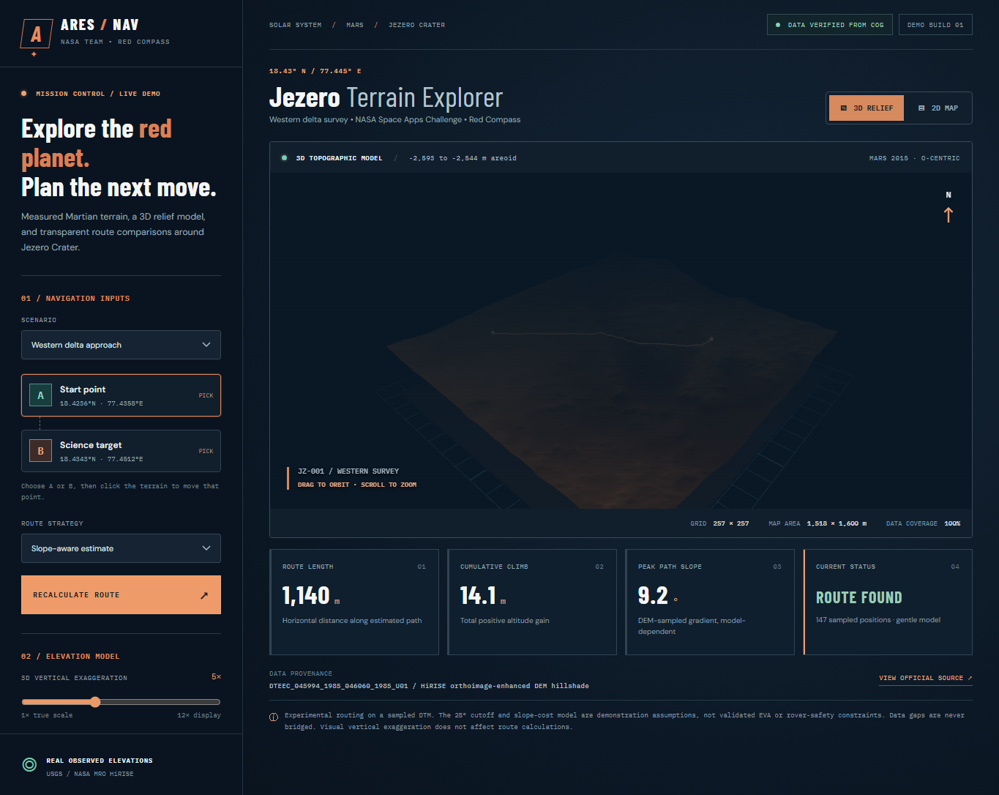
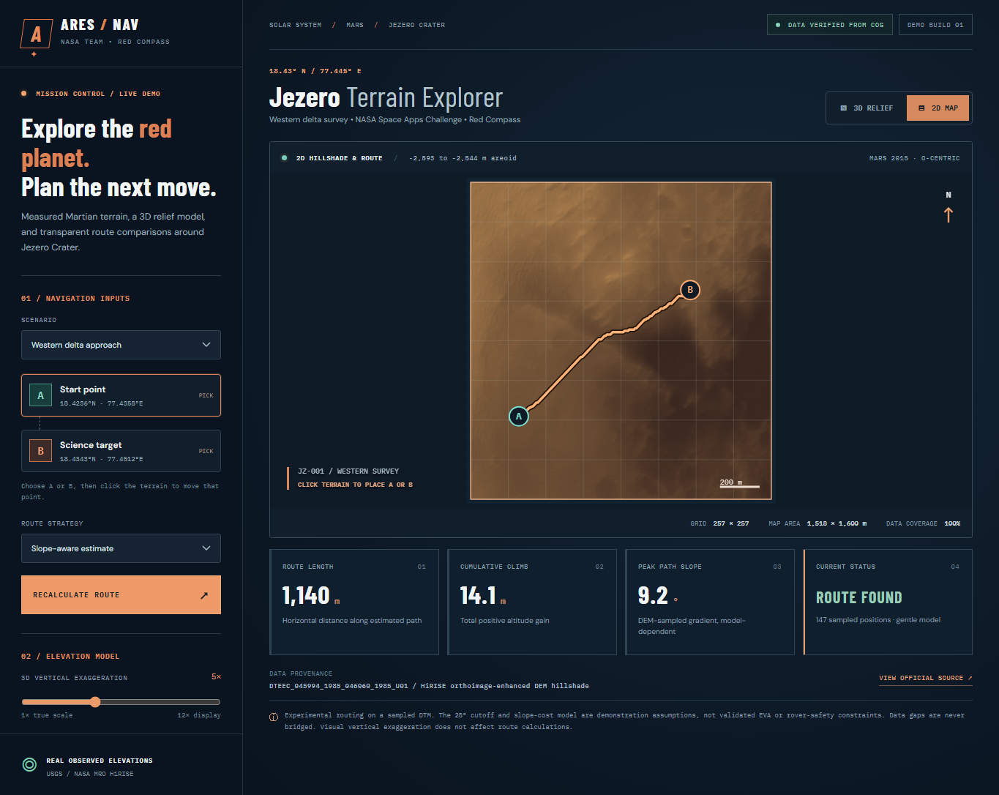

# ARES / Jezero Route Lab 🚀

**A working Mars terrain and route-planning proof of concept for Red Compass / NASA Space Apps.**

Explore a small part of **Jezero Crater** in interactive 2D and 3D using **real NASA MRO HiRISE elevation data published by USGS**. Compare two transparent A* route-cost strategies, move start/target points, and inspect measured terrain rather than a generated Mars-like landscape.



## Try it

**Live demo (GitHub Pages):** https://moamen-elsharkawy.github.io/ares-jezero-route-lab/

**Run locally:**

```bash
git clone https://github.com/Moamen-Elsharkawy/ares-jezero-route-lab.git
cd ares-jezero-route-lab
npm ci
npm test
npm run dev
```

Open the Vite URL printed in your terminal (usually `http://127.0.0.1:5173/`). The elevation data and texture are bundled; **no NASA account or API key is required** to run the app. You need Node.js/npm and a WebGL-capable browser for 3D; 2D falls back when WebGL is unavailable.

```bash
npm run build       # Production build for root hosting
npm run preview     # Preview a root-hosted production build
npm run build:pages # GitHub Pages build under /ares-jezero-route-lab/
```

## What the demo actually does

| Capability | Implementation |
| --- | --- |
| **2D map** | Georeferenced HiRISE orthorectified image + DEM-derived hillshade and route overlay |
| **3D terrain** | Three.js mesh sampled from the **same** real DEM data as the 2D map |
| **Interactive points** | Select A (start) or B (goal) and click either the 2D map or the 3D terrain |
| **Route comparison** | A* over neighboring grid cells, with shortest and slope-aware illustrative cost functions |
| **Route metrics** | Horizontal path length, cumulative ascent, maximum sampled local slope |
| **Controls** | Three built-in examples, 2D/3D switch, drag/orbit/zoom, 1×–12× visual vertical exaggeration |
| **Evidence** | Local Node tests, browser interaction QA, NASA/USGS source item, offline terrain assets |

**Important:** This is **a demonstration, not a NASA-certified EVA or rover route planner**. The 28° slope exclusion and routing penalties are developer assumptions, not validated vehicle/astronaut safety limits. These results are useful for comparison and explaining concepts, **not** for real mission navigation.



### Example: one real terrain patch, two model strategies

The **Traverse comparison** preset gives approximate results using the bundled downsampled HiRISE surface:

| Strategy | Horizontal distance | Maximum sampled path slope |
| --- | ---: | ---: |
| Slope-aware | 1,161 m | 9.85° |
| Shortest traversable | 1,150 m | 14.20° |

Both are computed from the same 257×257 sampled heights; the *policy* differs. The other presets may select identical routes under both policies, which is valid.

## Data provenance: real Mars, not Earth terrain

- **NASA mission/instrument:** Mars Reconnaissance Orbiter / HiRISE stereo DTM.
- **Publisher:** USGS Astrogeology, STAC collection `mro_hirise_socet_dtms`.
- **Item:** [DTEEC_045994_1985_046060_1985_U01](https://stac.astrogeology.usgs.gov/api/collections/mro_hirise_socet_dtms/items/DTEEC_045994_1985_046060_1985_U01).
- **Original DTM:** [USGS cloud-optimized GeoTIFF](https://astrogeo-ard.s3-us-west-2.amazonaws.com/mars/mro/hirise/controlled/dtm/ESP_045994_1985_ESP_046060_1985/DTEEC_045994_1985_046060_1985_U01.tif).
- **Orthorectified image:** same HiRISE DTM product bundle. See `orthoUrl` within the JSON metadata.
- **Window:** center 18.43° N / 77.445° E in western Jezero; 1,600 m projected square, corresponding to approximately 1,518 m east-west at this latitude.
- **Resolution:** original DTM posting approximately 1.0165 m; bundled *downsampled* grid 257×257 (roughly 6 m sample spacing).
- **Heights:** approximately −2,592.63 m to −2,544.04 m against the **Martian areoid** within the selected window.
- **CRS:** Mars (2015) sphere / planetocentric Equirectangular, IAU 49910. Horizontal east-west distances locally correct the map's equidistant cylindrical scale using cos(latitude).
- **Data coverage:** 100% *of the selected small window*, not all Jezero Crater.
- **Usage:** NASA/USGS source credited; public planetary data. Please consult original dataset metadata and terms for redistribution.

The pipeline `scripts/prepare_jezero.py` reads a **real** USGS Cloud Optimized GeoTIFF using remote HTTP ranges and stores a self-contained sample as `public/data/jezero-grid.json`. It uses the matching orthorectified image and a derived hillshade to generate `public/data/jezero-surface.png`. No synthetic elevation equation or Earth DEM is used.

To reproduce the sample with **Python 3.12**:

```bash
python -m pip install rasterio numpy Pillow requests
python scripts/prepare_jezero.py
```

No full-size original GeoTIFF is stored in the repository.

## Architecture and paths

```text
src/
  main.js                  2D canvas + Three.js interaction and 3D mesh
  navigation.js            A* routing, measurement, geographic transforms
  styles.css               responsive mission-control UI
public/data/
  jezero-grid.json         real sampled heights, metadata, bounds and source
  jezero-surface.png       rendered surface texture, aligned to DEM
scripts/
  prepare_jezero.py        reproducible USGS raster sampling pipeline
tests/
  navigation.test.mjs      6 automated verification tests
.github/workflows/
  deploy.yml               test, build and deploy GitHub Pages
docs/
  TEAM-INTEGRATION.md      integration notes and scientific limitations
QA-2026-11-14.md           observed local tests and screenshots
```

The 3D mesh and 2D map use **the same heightfield** and point coordinates. Routing happens on the original measured elevation values in meters; the 3D vertical exaggeration slider **does not change route calculations**.

For module boundaries, prerequisites and future improvements see [integration guide](docs/TEAM-INTEGRATION.md). For exact local test evidence see [QA record](QA-2026-11-14.md).

## Known limitations and next steps

- No full-planet terrain, global Jezero raster mosaicking, tile streaming, live rover feed or cloud back end.
- The test A* cost weights and 28° limit are **illustrative**. No validated astronaut/rover mobility, life-support, radiation, weather, lighting, soil properties or obstacle physics.
- Stereo DTM uncertainties / Figure of Merit need review before making scientific risk claims.
- ~6 m sample spacing cannot reveal rocks smaller than a pixel.
- A and B are demonstration points, not documented rover locations or actual science site selections.
- Future team integration should first agree on the map projection, area of interest, hazard data, navigation constraints and shared data contract.

## Credits and licensing

Built for **Red Compass / NASA Team** by **Moamen Elsharkawy**. This standalone demo was written with Three.js, and based on the **MIT-licensed Monolith visual-architecture idea**, not its Earth DEM code; no code from the unlicensed MARSCOPE repository was copied.

**Application source code:** MIT, see [LICENSE](LICENSE). **NASA/USGS data and derived visuals:** credited to the original public datasets; source-data terms remain separately applicable. No NASA endorsement is implied.
